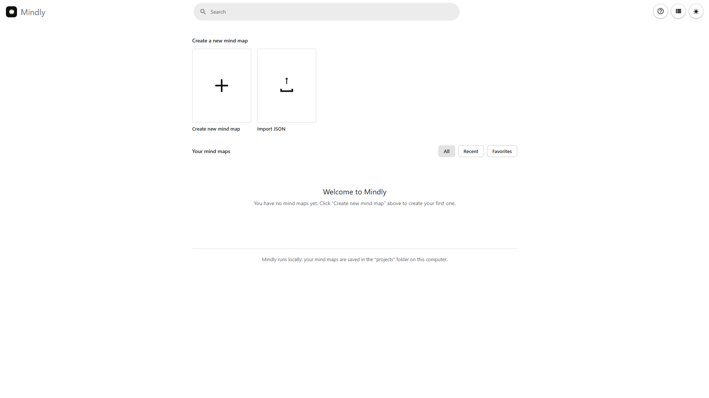
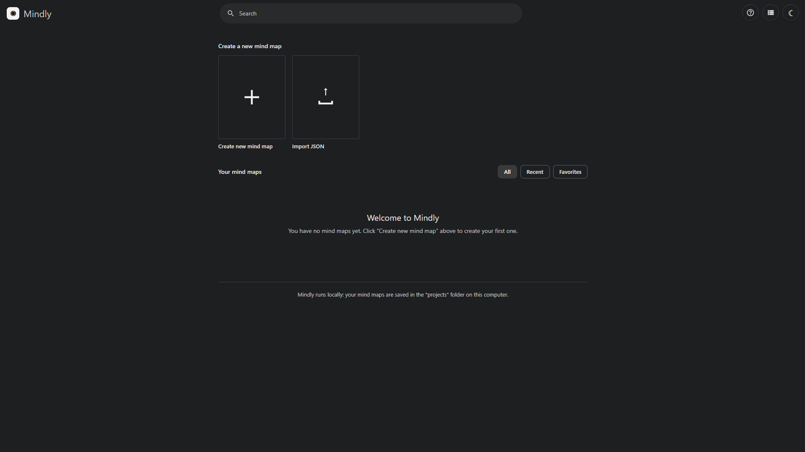
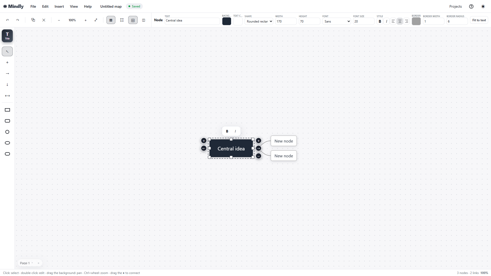
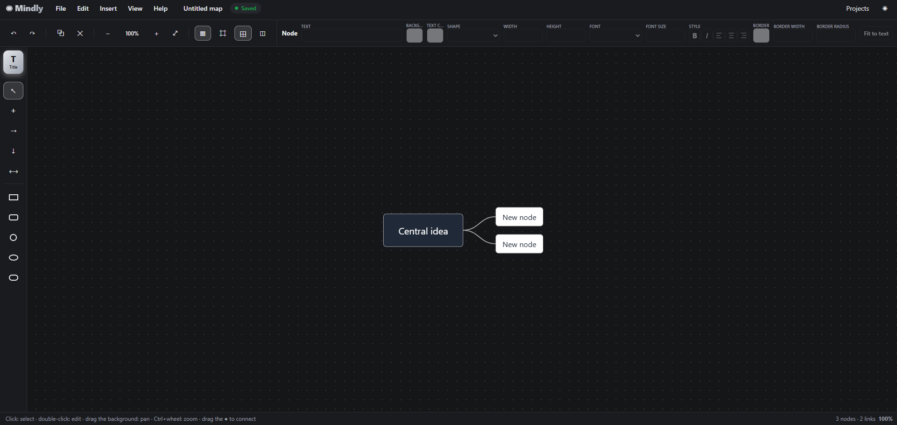

# Mindly

**Mindly** is a mind map editor that runs entirely on your computer: no account, no cloud, no Internet. Your maps are plain files in the `projects/` folder.









---

## How to use

### Start

1. Install **Python 3** (tick *Add Python to PATH*): <https://www.python.org/downloads/>
2. Unzip the `Mindly` folder anywhere.
3. Double-click **`start.bat`**. The browser opens Mindly at `http://127.0.0.1:8765`.

On macOS/Linux run `python3 server.py` inside the `Mindly` folder.

Everything stays inside the `Mindly` folder (projects **and** preferences), so you can copy it to a USB stick or another PC and find everything as you left it. See [Portability](#portability).

To quit: wait for **Saved** at the top, close the tab, then close the black server window (or `Ctrl+C`).

### First steps

1. In the Projects window click **New project** (or **Import** a `.json`).
2. Select the central block, press **`Tab`** and type: a linked child appears. **`Enter`** adds a sibling, **`Esc`** stops.
3. Everything saves automatically about 1.5 seconds after each change.
4. You can select **several files at once** when importing. With 2 or more, Mindly asks: **Separate projects** (each file becomes its own project, exactly as if imported one at a time, and none is opened automatically) or **One project, one page per file** (a single project whose pages follow the imported files; a file that already has pages keeps them).
5. Export from **File ▸ Export** (PDF, PNG, SVG, JSON, XMind, FreeMind, OPML, Markdown). Import from **File ▸ Import…** or the Projects window.

### Quick commands

| Keys | Action | Keys | Action |
|---|---|---|---|
| `Tab` / `Shift+Tab` | Child block right / left | `Ctrl+Z` / `Ctrl+Y` | Undo / Redo |
| `Enter` | Sibling block | `Ctrl+C` `X` `V` `D` | Copy / Cut / Paste / Duplicate |
| `F2` or double-click | Edit text | `Delete` | Delete selection |
| `N` / `T` | New block / Title block | `Ctrl+A` | Select all |
| `L` | Link mode | `Ctrl+F` | Find in map |
| `Ctrl+B` / `Ctrl+I` | Bold / Italic | `Ctrl+S` | Save |
| `Ctrl+wheel` / pinch | Zoom | `Ctrl+Shift+S` | Save as / duplicate |
| `+` `-` `0` `1` | Zoom in / out / 100% / fit | `Shift+PageUp/Down` | Previous / next page |
| `Space`+drag | Pan | `F1` or `?` | All shortcuts |

---

## Full list of commands

### Keyboard shortcuts

**File and project**

| Keys | Action |
|---|---|
| `Ctrl+N` | New project |
| `Ctrl+O` | Open project |
| `Ctrl+S` | Save |
| `Ctrl+Shift+S` | Save as / duplicate |
| `Ctrl+W` | Close project |

**Edit**

| Keys | Action |
|---|---|
| `Ctrl+Z` | Undo |
| `Ctrl+Y` / `Ctrl+Shift+Z` | Redo |
| `Ctrl+C` / `Ctrl+X` / `Ctrl+V` | Copy / Cut / Paste |
| `Ctrl+D` | Duplicate |
| `Delete` / `Backspace` | Delete |
| `Ctrl+A` | Select all |
| `Ctrl+F` | Find in map (search popup, top-right) |
| `Esc` | Deselect / cancel the current operation / close a window |

**Creating blocks**

| Keys | Action |
|---|---|
| `Tab` | Child block on the right, linked |
| `Shift+Tab` | Child block on the left, linked |
| `Enter` | Sibling block below, linked to the same parent |
| `F2` | Edit the text of the selected block |
| `T` | Title block |
| `N` | New block (at the mouse position) |
| `L` | Link mode |

**While typing in a block**

| Keys | Action |
|---|---|
| `Enter` | Confirm the text |
| `Shift+Enter` | New line |
| `Esc` | Cancel the edit |
| `Tab` / `Shift+Tab` | Confirm and create a child on the right / left |
| `Ctrl+B` / `Ctrl+I` | Bold / Italic |
| `Ctrl+Shift+E` | Center the text |

**View and navigation**

| Keys | Action |
|---|---|
| `+` / `-` (or `Ctrl++` / `Ctrl+-`) | Zoom in / out |
| `0` | Reset zoom to 100% |
| `1` (or `Ctrl+0`) | Fit the map to the screen |
| `Ctrl+wheel` or **pinch** on the trackpad | Zoom around the pointer |
| `Wheel` / `Shift+wheel` or **two-finger swipe** | Scroll vertically / horizontally |
| `Space`+drag or middle button | Pan, even over a block |
| `Shift+PageUp` / `Shift+PageDown` | Previous / next page |
| `F11` | Full screen |
| `F1` or `?` | Keyboard shortcuts window |

While you type in a text field (project name, Properties panel, search) the editor shortcuts are disabled; only `Ctrl+S`, `Ctrl+Shift+S`, `Ctrl+O`, `Ctrl+N`, `Ctrl+F` and `F1` stay active. Browsers may reserve `Ctrl+N` and `Ctrl+W`: use the **File** menu instead.

### Mouse

| Action | What it does |
|---|---|
| Click a block | Select |
| `Shift`/`Ctrl` + click | Add / remove from the selection |
| `Shift`/`Ctrl` + drag on the background | Box selection |
| Double-click a block | Edit its text |
| Double-click the background | New block |
| Right double-click the background | Title block |
| Right-click a block / the background | Context menu |
| Click a line | Select the link |
| Drag a block | Move it with its whole branch |
| `Alt` + drag a block | Move only that block |
| Drag a block onto another | Change parent (target turns orange) |
| Drag a handle (8 around the block) | Resize; `Shift` keeps proportions |
| Drag the ● dot | Link the block to another |
| Drag the background / middle button | Pan |
| Wheel / `Shift`+wheel / `Ctrl`+wheel | Scroll / scroll sideways / zoom |

### Laptop trackpad and touch screen

Mindly follows the same conventions as Figma, Miro, tldraw and Excalidraw:

| Gesture | What it does |
|---|---|
| Two-finger swipe | Scroll the map in any direction |
| Pinch (two fingers) | Zoom around the pointer (also Safari on macOS) |
| Two-finger tap | Context menu (right-click) |
| Touch screen: two fingers | Pinch to zoom and pan at the same time |
| Drag the background (**Trackpad mode**) | Box selection, instead of panning |
| `Space`+drag or middle button | Pan, even in Trackpad mode |

- **Trackpad mode** (View menu or the ✥ toolbar button): it is **on** by default; you can turn it off and Mindly remembers your choice (`mTrackpad` in `projects/preferences.json`). With it on, dragging the empty background draws a selection box (no `Shift` needed) and you move around with two fingers. Turn it off to go back to dragging the background to pan.
- The browser's own page zoom and the two-finger horizontal swipe (Back/Forward) are blocked over the map, so a pinch or a swipe never leaves the page.
- Gestures are merged and applied once per frame, and block drags start only after ~5 px so a slightly moving tap does not move a block.

### Interface buttons

- **Toolbar**: Undo, Redo, Duplicate, Delete, Zoom −, zoom % (click = 100%), Zoom +, Fit to screen, Grid, Snap, Tidy/free mode, Trackpad mode, Minimap, Properties.
- **Tools panel (left)**: Title block, Select, New block, Child block, Sibling block, Link mode, and five shapes (rectangle, rounded rectangle, circle, ellipse, pill).
- **Around a selected block**: ＋ add child, → / ← drag to link, − collapse/expand the branch (one set on each side); a small **B / I** bar above it.
- **Top bar**: menus, project name (click to rename), save status, Projects, Help, theme.
- **Page switcher (bottom left)**: `‹ Page name ▾ ›` and **＋** for a new page.

### Menus

- **File**: New project · Open project… · Save · Save as / duplicate… · Rename project… · Close project · Export ▸ (PDF, PNG, SVG, JSON, XMind, FreeMind, OPML, Markdown) · Import… (JSON, XMind, FreeMind, OPML, Markdown/text) · Preview… · Project path…
- **Edit**: Undo · Redo · Cut · Copy · Paste · Duplicate · Delete · Select all · Deselect / cancel · Find in map…
- **Insert**: Title block · New block · Child block · Child block on the left · Sibling block · Link mode · New page
- **View**: Properties · Minimap · Zoom in / out / 100% · Fit map · Previous / next page · Grid · Snap to grid · Tidy mode · Trackpad mode · Full screen · Light/dark theme
- **Help**: Keyboard shortcuts · About Mindly

### Context menus (right-click)

- **Background**: New block · Paste · Select all · Zoom in · Zoom out · Fit map · Grid
- **Block**: Edit text · Create child · Create sibling · Duplicate · Copy · Delete · Link · Properties

---

## Full list of functions

### Blocks

- **Create**: double-click, `N`, `T`, `Tab`, `Shift+Tab`, `Enter`, ＋ button, shape buttons, Insert menu. New blocks go in a free spot and start in typing mode.
- **Title block**: dark style, 20 px, usable as the map's main block. The first title block of the first page is linked to the **project name** (and its folder).
- **Shapes**: rectangle, rounded rectangle (default), circle, ellipse, pill.
- **Auto-size**: blocks fit their text (about 90–340 px wide, growing in height while you type). Resize manually and the block keeps your size until you press **Fit to text**.
- **Resize**: 8 handles, `Shift` for proportions, minimum 40 × 24 px, follows the grid when snap is on.
- **Select / move**: single, multiple, box, select all. Moving drags the whole downstream branch (`Alt` = block only).
- **Change parent**: drag a block onto another; loops are prevented.
- **Collapse / expand** each side of a block independently; a badge shows the hidden count. The state is saved and undoable.
- **Search**: live, case- and accent-insensitive; matches are outlined in orange, others fade; `Enter` / `Shift+Enter` move between matches and open collapsed branches.
- **Copy / cut / paste / duplicate**: include the links between the selected blocks; paste works between pages, between projects and between browser tabs (see [Multiple tabs](#multiple-tabs)).

### Links

- **Create**: drag the ● dot, link mode (`L`), context menu → Link, or `Tab` / `Shift+Tab` / `Enter`.
- **Style**: type (straight, curve, orthogonal), color, thickness 1–30, dashed, start and end (none, arrow, dot), optional label (bold/italic).
- **Behavior**: lines attach to the middle of a block side, follow blocks automatically and have a direction (parent → child). A bar above a selected line gives color, arrow and dashed.

### Layout

- **Tidy mode** (default): the map arranges itself on both sides of the main block, parents centered on their children, recalculated after every change. Sibling order follows vertical position; dragging a child of the main block across switches its side. **Changing a link's side:** drag any block to the right, left or below its parent (a colored bar shows the side it will attach to) and its link switches to that side: a right/left block dragged below its parent becomes a bottom branch, and a bottom block dragged to the right or left becomes a side branch again.
- **Free mode**: blocks stay exactly where you put them.

### Properties panel (☰)

Applies to all selected blocks. **Block**: text, fill, text color, shape, width, height, font (Sans, Serif, Mono, Script), size 6–200, bold, italic, alignment, border color, border width 0–30, border radius 0–200, opacity 10–100%, Fit to text. **Link**: color, thickness, type, dashed, start/end, delete.

### Canvas

- Zoom 10–400% (Ctrl+wheel, trackpad pinch, touch pinch), pan (two-finger swipe, Space+drag), fit to screen, 20 px dotted grid and snap (saved with the project), saved view position and zoom.
- **Minimap** (off by default): grab the small rectangle and drag it freely (it stays where you grabbed it, no jump); click elsewhere and the view glides there;  + / − zoom, click the % to reset, pin to the corner or drag it anywhere, resize from the four corners. It is always translucent (the map shows through), fades in smoothly, redraws once per frame and only slides the small view rectangle while you pan, and that rectangle is kept small inside the minimap.

### Pages

Several maps in one project. Switch with the arrows, the page panel or `Shift+PageUp/Down`; create with ＋ or Insert → New page; rename, duplicate, delete and drag to reorder from the panel. Undo history is per page; settings are shared; search, minimap and the status counters work on the current page.

### Projects

- **Projects window**: search, sort (last modified, creation date, name), recent list, open with one click on the row.
- **Actions**: New, Import JSON, Rename, Duplicate, Delete (double confirmation, optional export first; the folder goes to the **Recycle Bin / Trash**), Close, show the full folder path.
- **Names**: up to 60 characters, spaces allowed, invalid Windows characters removed, duplicates get `_2`, `_3`…; folders are named `NAME_Mindly`.

### Other mind map formats

Choose **File ▸ Export** or **File ▸ Import…** (also the Import buttons on the home and in the Projects window). Mindly picks the format from the file.

| Format | Extension | Export | Import | Notes |
|---|---|---|---|---|
| **XMind** | `.xmind` | yes | yes | One sheet per page. Opens in XMind 2020 and later; the file also contains the older XMind 8 data. Import reads both. |
| **FreeMind / Freeplane** | `.mm` | yes | yes | Left/right sides are kept. |
| **OPML** | `.opml` | yes | yes | Works with outliners and many mind map apps. |
| **Markdown / text outline** | `.md` `.markdown` `.txt` | yes | yes | Headings and bullet lists (or indented lines) become blocks. |
| **Mindly JSON** | `.json` | yes | yes | Full backup with every page and style. |

- The structure and the text are converted: **blocks, parent/child links, pages and left/right sides**. Colors, fonts, link styles, labels, notes, images and icons are not carried over, and imported maps open in tidy mode with the default style.
- XMind, FreeMind, OPML and Markdown hold one tree per page: a page with several unconnected blocks keeps the first title block as the main block and attaches the others to it. Formats with a single map (FreeMind, OPML, Markdown) put a multi-page project under one root named after the project.
- Importing XMind needs a recent browser (Chrome, Edge, Firefox, Safari from 2023).

### Undo, save, export

- **Undo / Redo**: 300 steps per page; quick repeated edits are grouped.
- **Save**: autosave after about 1.5 s, manual `Ctrl+S`, status *Saved / Saving… / Unsaved changes / Save error*, safe atomic writes, last save attempt when closing the tab.
- **Export**: PDF (one page per map page, image-based), PNG (2×), SVG (vector), JSON (whole project). All exports use a white background, whatever the theme.
- **Other mind map formats** (import and export), see the table below.
- **Import**: always creates a new project and never overwrites an existing one. **Preview** shows the final map with export buttons.
- **Theme**: light or dark.
- **Preferences**: theme, recent projects, favorites, home view (grid or list), Properties panel visibility and last opened project are saved in `projects/preferences.json`, not in the browser. The file is created automatically and updated about 0.3 s after each change.

---

## About the project

### Folder structure

```
Mindly/
├── Mindly.exe     ← double-click to start, no Python needed (standalone, ~7 MB)
├── start.bat      ← alternative start, needs Python
├── build_exe.bat  ← rebuilds Mindly.exe (needs Python + PyInstaller)
├── server.py      ← local server and API (Python standard library only)
├── README.md
├── images/        ← 4 screenshots (home and editor, light and dark)
├── static/        ← index.html, style.css, app.js (the editor)
└── projects/      ← your maps: one folder each, with project.json + metadata.json
    └── preferences.json  ← your preferences (created automatically, do not delete)
```

### How it works

- **Backend**: `server.py` serves the site and saves projects to disk through a small REST API. It listens only on `127.0.0.1:8765` and checks names, JSON structure and size (max ~25 MB).
- **Frontend**: plain HTML, CSS and JavaScript with no framework or external libraries; the map is drawn in SVG. PDF, PNG and SVG are generated in the browser.
- **Privacy**: nothing leaves your computer and it works fully offline.
- **Data**: `project.json` holds blocks, links, settings, view and pages; `metadata.json` holds name, ID, dates and version. `projects/preferences.json` holds the preferences (theme, recent, favorites, view, panel). Backup = copy the whole `Mindly` folder (or just `projects/`, which already contains `preferences.json`), or use Export JSON → Import.

| Method | Path | Function |
|---|---|---|
| `GET` / `POST` | `/api/projects` | list / create |
| `GET` / `PUT` / `DELETE` | `/api/projects/<id>` | read / save / move to Recycle Bin |
| `GET` | `/api/projects/<id>/path` | folder path on disk |
| `POST` | `/api/projects/<id>/rename` · `/duplicate` | rename / duplicate |
| `GET` / `PUT` | `/api/prefs` | read / replace `projects/preferences.json` |
| `POST` | `/api/prefs` | merge changed keys `{"set": {…}, "remove": […]}` (used by the editor, safe with several tabs) |

### Multiple tabs

Open Mindly in as many browser tabs as you like (File ▸ **New browser tab**, or **↗** on a project in the home / Projects window, or `Ctrl`+click / middle-click on a project).

- **Separate projects**: each tab works on its own project, with its own undo history and its own saving. The tab's address ends with `#project-folder`, so reloading the tab reopens the same project.
- **One project, one tab**: a project open in a tab cannot be opened, renamed or deleted from another tab (a message tells you); this prevents two tabs from overwriting each other.
- **Copy and paste across tabs, pages and projects**: select, `Ctrl+C` (or `Ctrl+X`) in one tab, then `Ctrl+V` in another tab, page or project. Links between the copied blocks are kept. Pasted into a *different* page or project, blocks keep their position; on the *same* page they are shifted slightly.
- **Nothing in the browser**: Mindly stores nothing in the browser (no localStorage, no cookies, no cache; the server sends `no-store`). Preferences **and the copy/paste clipboard** live in `projects/preferences.json` (clipboard key `mClip`, emptied each time the server starts). Anything older versions left in the browser is erased on load.
- **Shared preferences**: theme, recent projects, favorites and view stay in sync between tabs; the minimap state is per tab.

### Portability

- Mindly does not use the browser's storage: projects live in `projects/` and preferences in `projects/preferences.json`.
- To move Mindly (USB stick, another PC), copy the whole `Mindly` folder. Theme, recent projects and favorites come with it.
- Preferences refer to projects by folder name; since `preferences.json` is inside `projects/`, copying `projects/` is enough to keep both.
- **Do not delete `projects/preferences.json`**: it holds your theme, recent projects, favorites and view settings. If you delete it, Mindly recreates it empty and you lose those settings (your maps are not affected).
- On first start after updating from an older version, the preferences still stored in the browser are copied once into `preferences.json`. After that the browser copy is ignored and can be deleted.
- If Mindly runs from a read-only drive, projects cannot be saved either: copy the folder to a writable location.
- The minimap (position, size, pin) is not saved and starts off at every launch.

### Limits and tips

- Bold and italic apply to the whole block, not single words.
- PDF export is an image (text not selectable); use SVG for vector output.
- XMind, FreeMind, OPML and Markdown keep structure and text only (no colors, notes or images). The `.xmind` export has not been checked in every XMind version.
- JSON, PDF, PNG, SVG and XMind cover every page; search, minimap and counters cover the current page; there are no links between pages (max 100 pages).
- Preferences not applied? Check that `projects/preferences.json` exists and is writable. Old version still showing? Reload with `Ctrl+F5`. Port 8765 busy? Mindly is already running: close the other window.

---

*Mindly: local mind map editor. All data stays on your computer.*
